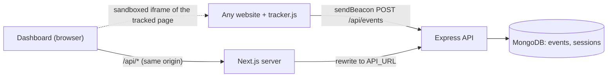

# CausalFunnel Analytics: Session Tracking and Click Heatmaps

A small full-stack user analytics app. A drop-in JavaScript tracker records page views and clicks on any website, a Node.js API stores them in MongoDB, and a Next.js dashboard shows each session as an ordered user journey and every page as a click heatmap.

## Features

**Tracking script (`backend/public/tracker.js`)**
- One `<script>` tag, no dependencies, about 5 KB unminified
- Tracks `page_view` on load and on client-side navigation (`history.pushState`, back/forward), and `click` with page x/y coordinates
- Every event carries `session_id`, event `type`, page `url`, `timestamp` and, for clicks, `x`/`y`, plus viewport and document size and a short description of the clicked element (tag, id, visible label)
- `session_id` is kept in `localStorage`, with a cookie fallback when storage is blocked. A session ends after 30 minutes without activity, like most analytics tools
- Events are batched and sent with `navigator.sendBeacon` as `text/plain`, so they survive page navigation and never trigger a CORS preflight. `fetch` with `keepalive` is the fallback
- Never records what users type. For inputs only the `aria-label`, placeholder or name is kept

**API (`backend/`)**
- Receive and store events, single or batched, with per-event validation
- Idempotent ingestion: each event has a client-generated id, so retries never double count
- List sessions with event counts, fetch a session's events in order, list tracked pages, fetch click data for a page split by device class
- Serves the tracker and a three-page demo store ("Ember Roasters") to try it on

**Dashboard (`frontend/`)**
- **Sessions:** every session with total events, duration, device and entry page, newest first, paginated and refreshing every 5 seconds. Clicking one shows the user journey: each page view in order with the clicks made on that page, time offsets from the start of the session and click coordinates
- **Heatmap:** pick a page URL and a device class (desktop, tablet, mobile, each with its click count). Clicks are drawn as dots or as a density grid on top of a live, script-free render of the page itself. A "Top click areas" list gives the same data as text
- Page, device and display mode live in the URL, so a heatmap view can be shared
- Light and dark themes, loading, empty and error states, works down to phone widths

## Tech stack

- **Tracker:** plain ES5-compatible JavaScript
- **Backend:** Node.js 20, Express 5, TypeScript, official MongoDB driver, zod
- **Database:** MongoDB
- **Frontend:** Next.js 16 (App Router, TypeScript), React 19, Tailwind CSS 4, SWR, lucide-react
- **Testing:** Vitest with supertest and mongodb-memory-server for the API, jsdom for the tracker, Vitest and React Testing Library for the dashboard, Playwright end to end

## Architecture



- The dashboard calls a relative `/api/*` path and `next.config.ts` rewrites it to the API, so the browser never makes cross-origin calls from the dashboard. Only the tracker posts cross-origin, and the API allows that from any origin.
- **Backend layers**
  - `routes/`: thin HTTP handlers (body shapes, status codes)
  - `services/events.ts`: validation, URL normalisation, device class, idempotent insert and the session rollup
  - `services/sessions.ts`: session list and journey
  - `services/heatmap.ts`: page list and click data
  - `schemas.ts`: zod schemas for events and query strings
  - `devMemory.ts`: boots an in-memory MongoDB, so the API runs without installing Mongo
- **Frontend layers**
  - `lib/`: typed API client, SWR hooks, and pure utilities for formatting, journey grouping and heatmap bucketing
  - `components/sessions`: session list and journey
  - `components/heatmap`: page and device picker, dot and grid renderers, hotspots
  - `components/ui`, `components/layout`: shared states and the app shell

## Data model

Two collections. `events` is the source of truth. `sessions` is a rollup kept in step on every insert so the session list is a single indexed read instead of an aggregation over all events.

**`events`**
```js
{
  _id: ObjectId,
  event_id: "6d1f…",                 // client-generated, unique
  session_id: "54fcd735-…",
  type: "click",                      // or "page_view"
  url: "https://shop.test/demo/",    // origin + path, no query or hash
  path: "/demo/",
  title: "Home · Ember Roasters",
  referrer: "https://google.com/",
  timestamp: ISODate,                 // client time, clamped if far in the future
  received_at: ISODate,
  x: 121, y: 1263,                    // clicks only, page coordinates in CSS px
  target: { tag: "button", id: "buy", text: "Add to cart" },
  viewport: { width: 1440, height: 900 },
  document: { width: 1440, height: 2400 },
  device: "desktop",                  // from viewport width
  user_agent: "Mozilla/5.0 …"
}
```

**`sessions`**
```js
{
  _id: "54fcd735-…",                  // the session_id
  first_seen: ISODate, last_seen: ISODate,
  event_count: 9, page_views: 3, clicks: 6,
  entry_url: "https://shop.test/demo/",
  device: "mobile",
  user_agent: "Mozilla/5.0 …"
}
```

**Indexes**
- `events.event_id` unique: deduplicates retries
- `events (session_id, timestamp)`: a session's journey in order
- `events (url, type, device, timestamp)`: heatmap clicks for a page and device, newest first
- `sessions.last_seen`: newest sessions first

**Design notes**
- Ingestion is an unordered bulk upsert keyed on `event_id` with `$setOnInsert`. Only events that were actually inserted are added to the session rollup with `$inc`, `$min` and `$max`, so counts stay right under retries and when batches arrive out of order.
- URLs are normalised to origin plus path, and a trailing `index.html` is dropped, so `/demo/`, `/demo/index.html` and `/demo/?utm_source=x` are one page. This also keeps query strings, which often carry personal data, out of the database.
- Device class comes from viewport width (mobile < 768px, tablet < 1024px, desktop otherwise). Heatmaps are always split by it because a responsive page moves its content around between widths, so mixing them puts dots in the wrong place.

## API overview

All routes are prefixed with `/api`.

- `POST /events`: body is one event, an array, or `{ events: [...] }` (at most 50), as `application/json` or `text/plain`. Returns `202 { accepted, duplicates, rejected }`. Invalid events are dropped and counted, `400` only if none are valid, `413` for oversized batches
- `GET /sessions?page=1&limit=20`: `{ sessions, total, page, limit }`, newest activity first. Each session has `event_count`, `page_views`, `clicks`, `duration_ms`, `entry_url`, `device`
- `GET /sessions/:id/events`: `{ session, events }` with events in time order, `404` if unknown
- `GET /pages`: tracked page URLs with `page_views`, `clicks` and `last_seen`, most clicked first
- `GET /heatmap?url=…&device=desktop|tablet|mobile`: `{ clicks: [{x, y}], total, devices, viewport_width, page_height }`. Returns the latest 5,000 clicks, and `total` gives the full count
- `GET /health`

Static routes: `/tracker.js` and the demo store at `/demo/`.

## Running locally

Prerequisites: Node.js 20.9+. MongoDB is optional for development.

```bash
# API (http://localhost:4000, demo store at /demo/)
cd backend
npm install
npm run dev:memory        # in-memory MongoDB, data resets on restart
# or, with a real MongoDB:
docker-compose up -d      # from the repo root, starts mongo:8 on 27017
npm run dev               # MONGODB_URI defaults to mongodb://localhost:27017/causalfunnel

# Dashboard (http://localhost:3000)
cd frontend
npm install
cp .env.example .env.local   # API_URL=http://localhost:4000
npm run dev
```

Then open http://localhost:4000/demo/, click around, and watch the session appear at http://localhost:3000/sessions.

**Adding the tracker to another site**

```html
<script src="https://YOUR-API-HOST/tracker.js" async></script>
```

The script posts to `/api/events` on the host it was loaded from. To send somewhere else, add `data-endpoint="https://…/api/events"`. It exposes `window.CausalFunnel.flush()`, `sessionId()` and `trackPageView()`.

**Backend environment variables**
- `MONGODB_URI`: default `mongodb://localhost:27017/causalfunnel`
- `PORT`: default `4000`
- `CORS_ORIGINS`: comma separated, default `*`. The tracker needs to post from the sites it runs on

**Frontend environment variables**
- `API_URL`: origin of the API that `/api/*` is proxied to. The "Open demo store" link points there too

## Testing

```bash
./scripts/test-all.sh            # everything below
SKIP_E2E=1 ./scripts/test-all.sh
```

- **API (Vitest + supertest + mongodb-memory-server):** ingestion of single, batched and `text/plain` bodies, deduplication, partial rejection, size limits, CORS, URL normalisation, clock skew, session counts across batches, ordering, pagination, journeys, page list, heatmap device split and sizing, static files
- **Tracker (Vitest + jsdom):** page views on load and on navigation, click coordinates and targets, no captured input values or page text, events the API accepts, session continuity, the 30 minute timeout, the cookie fallback, batching and flush on pagehide
- **Dashboard (Vitest + Testing Library):** formatting, journey grouping, heatmap bucketing, the API client, session list, journey, and the heatmap page picker, device switch, dot and grid modes, hotspots and empty states
- **End to end (Playwright):** starts the API on an in-memory MongoDB and the Next.js dev server, browses the demo store in one tab, then checks the journey and the heatmap in the dashboard

## Deployment

- **Database:** a free MongoDB Atlas M0 cluster. Put its connection string in `MONGODB_URI`.
- **API on Render (free plan):** `render.yaml` defines a Node web service rooted at `backend/`. Set `MONGODB_URI` in the dashboard. Free instances sleep after 15 minutes idle, so the first request can take about a minute.
- **Dashboard on Vercel (Hobby plan):** import the repo with **Root Directory** `frontend` and set `API_URL` to the Render service URL.

## Assumptions and trade-offs

- **No auth or multi-tenancy.** Any site can post events and anyone with the dashboard URL can read them. A real product would issue a site key per customer, check it on ingest and scope every query by it.
- **Sessions are per browser, not per user.** There is no identify call. Clearing storage or switching browsers starts a new session. Sessions use a 30 minute inactivity timeout rather than ending when the tab closes, so a user who opens two tabs shares one session.
- **Client timestamps are trusted** for ordering, since they reflect what the user did. They're replaced with server time only when more than 5 minutes in the future.
- **Delivery is best effort.** `sendBeacon` gives no response, so the tracker doesn't retry. Server-side deduplication means a retry layer could be added without double counting.
- **Heatmap alignment is approximate.** Clicks are stored in page coordinates and drawn at the median viewport width of their device class. Clicks from widths far from that median can drift on fluid layouts. Element-relative coordinates (selector plus offset) would be more exact, at the cost of a more complex tracker. Content that changes after load, such as carousels or menus, isn't captured either.
- **The page under the heatmap is a live iframe**, sandboxed so its scripts (including the tracker) don't run. Pages that set `X-Frame-Options`, need JavaScript to render, or are behind a login show the dots on a blank canvas instead. A production tool would store a DOM snapshot or screenshot at capture time.
- **The session rollup is updated in a second write** after events are inserted. If the API crashed between the two, counts for that batch would be short until rebuilt from `events`. A multi-document transaction would close that gap but needs a replica set.
- **No rate limiting or bot filtering**, and the event list endpoint is unpaginated, which is fine for sessions of a few hundred events.
- **Scale:** the sessions list uses skip/limit pagination and the page list aggregates over all events. Both are fine at assignment scale. Beyond that, cursor pagination and a `pages` rollup like `sessions` would be the next steps.
